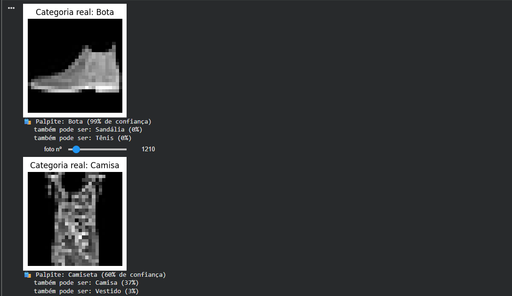

# 👕 NeuroStartup — Classificador de roupas por foto

Atividade Prática 3 · IA e Machine Learning · Prof. Hercules Ramos

## Integrantes

| Nome | R.A. |
|---|---|
| Eduardo Rafael Bacchiega | 1749416 |
| Diego Rossetto do Nascimento | 1727950 |
| Walace Alves de Araújo | 1327400 |
| Marcos da Silva Teixeira | 2158303 |

## O problema (em linguagem de negócio)

Um marketplace (inspiração: Mercado Livre, Shein) recebe milhares de fotos de vendedores por dia. Escolher a categoria de cada peça à mão é lento, e categoria errada faz o produto sumir da busca.
Nossa rede neural recebe a foto da peça e **sugere a categoria** (10 tipos), para o time de catálogo só confirmar.

**Resultado (preencher com a frase gerada no notebook):**
> A cada 100 peças fotografadas, a rede sugere a categoria certa em __, contra __ do modelo simples ...

## Como rodar

**Opção 1: Google Colab (mais fácil)**
1. Acesse <https://colab.new> e envie `NeuroStartup_roupas.ipynb` (Arquivo → Fazer upload de notebook).
2. Menu *Ambiente de execução → Executar tudo*.

**Opção 2: VS Code / local**
```bash
pip install numpy pandas matplotlib scikit-learn tensorflow ipywidgets joblib
jupyter notebook NeuroStartup_roupas.ipynb
```
Os dados (Fashion-MNIST) são baixados automaticamente pelo Keras. Não é preciso baixar nada manualmente.

## O que tem no repositório

| Arquivo | O que é |
|---|---|
| `NeuroStartup_roupas.ipynb` | Notebook rodado, com todos os resultados aparecendo |
| `experimentos.csv` | Registro de todas as tentativas (baselines e 4 redes) |
| `modelo_roupas.keras` | Modelo treinado salvo |
| `MODEL_CARD.md` | A "bula" do modelo (uso pretendido, não usar para, limitações) |
| `print_tela.png` | Print da tela interativa funcionando |

## Etapas

1. **Conhecer os dados:** 2 gráficos com conclusão; divisão treino (48 mil) / validação (12 mil) / teste (10 mil, o "cofre").
2. **Baseline × rede:** chute, regressão logística (baseline) e árvore de decisão × 4 redes Keras, com dropout e early stopping; curvas de aprendizado no notebook.
3. **Abrir o cofre:** teste usado uma única vez, comparação com o baseline e frase de negócio.
4. **Produto:** modelo salvo, função `classificar_roupa()` e painel com `interact`.
5. **Documentação:** este README + `MODEL_CARD.md`.

## Tela do produto



## Declaração de uso de IA

> (Preencher com honestidade: quais ferramentas de IA foram usadas, em quais partes e para quê. Exemplo de formato abaixo.)

- Ferramenta: Claude
- Onde usamos: estrutura inicial do notebook, revisão do código e auxílio no README

## Segurança

Nenhuma senha ou chave de API está no código.
